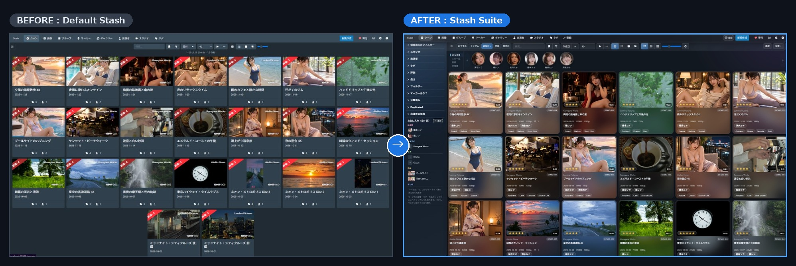
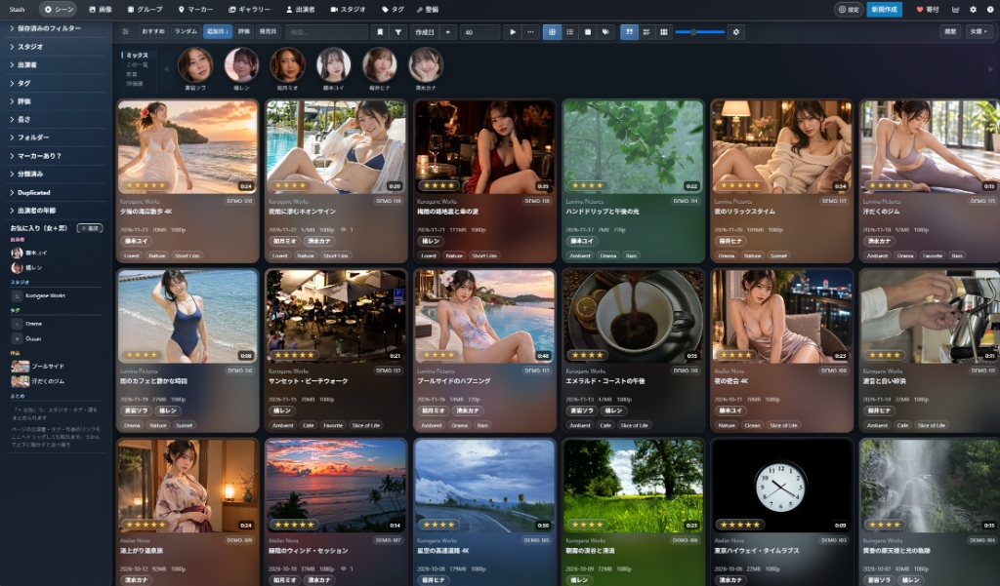
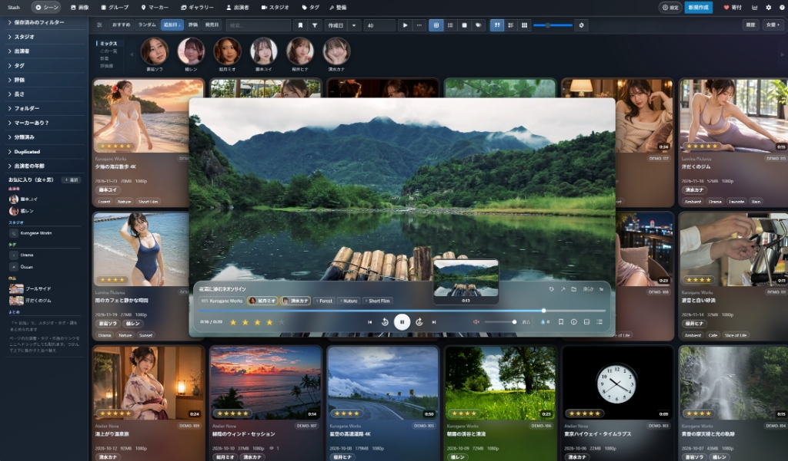
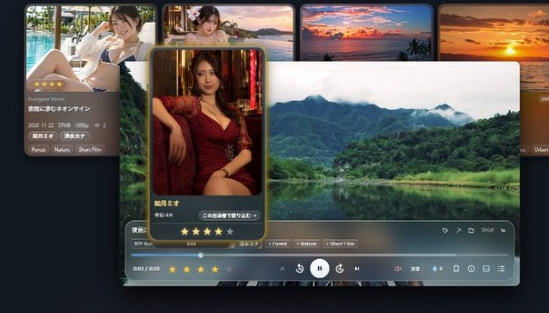
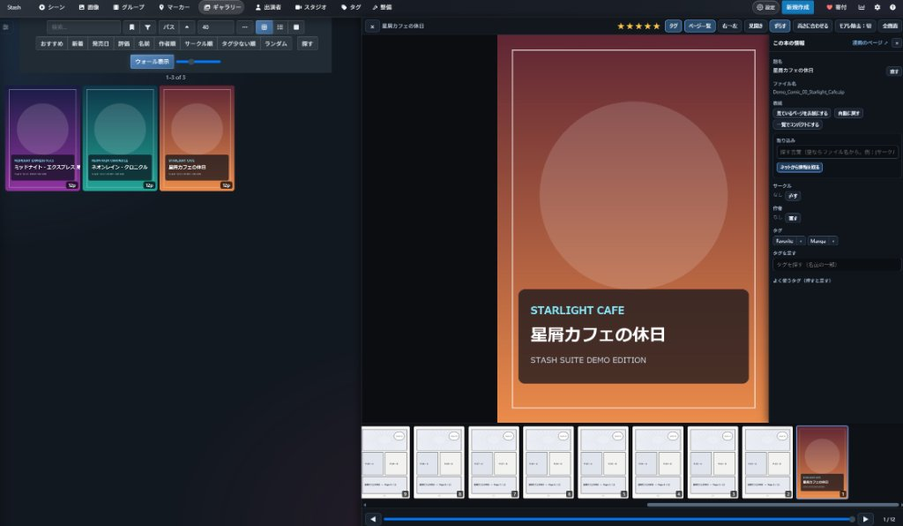
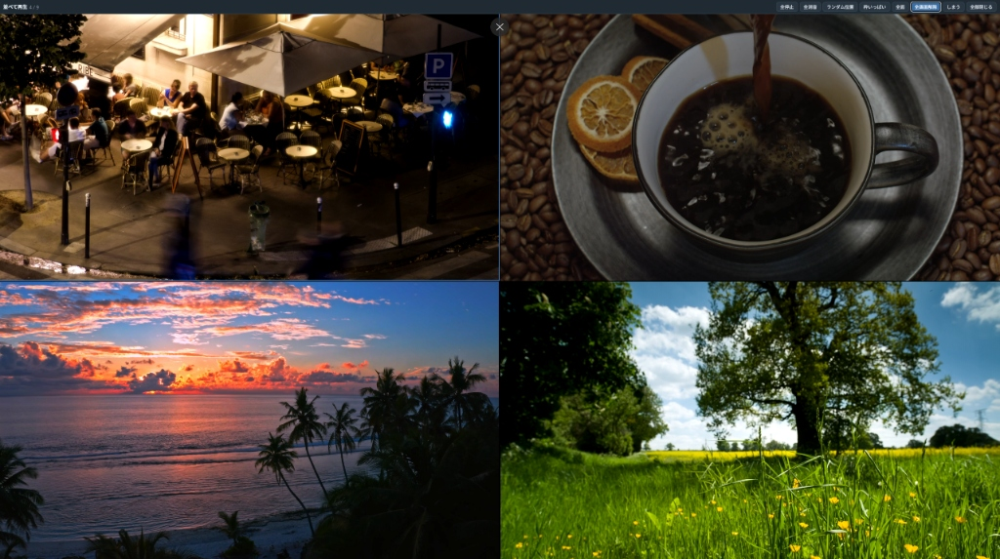
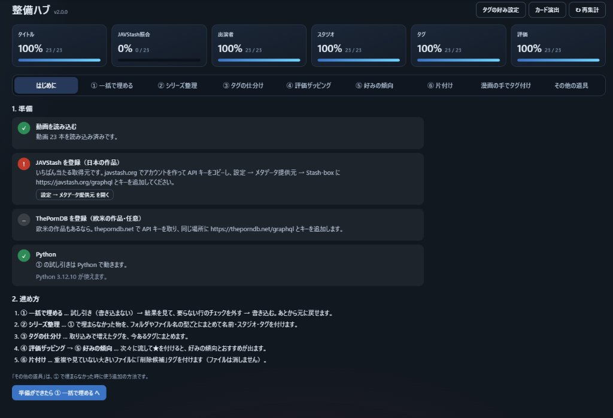
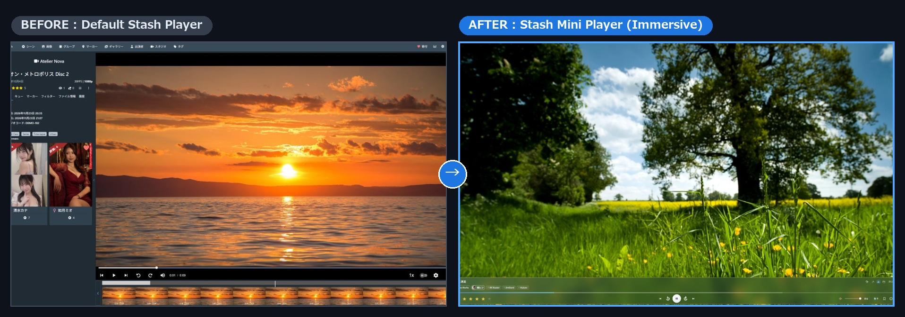

# Stash Suite (Free Edition)

**English** | [日本語](./README_JA.md) | [繁體中文](./README_ZH_TW.md) | [简体中文](./README_ZH_CN.md) | [한국어](./README_KO.md)

A drop-in plugin suite that upgrades [StashApp](https://stashapp.cc/)'s browsing, playback, library organization, and reading experience — optimized for large **JAV, local video, and manga / doujinshi** collections.  
No external Python packages (`pip`) or extra servers required — just copy the folders into your Stash `plugins` directory.

- **5 Languages Built-in**: English, 日本語 (Japanese), 繁體中文 (Traditional Chinese), 简体中文 (Simplified Chinese), 한국어 (Korean)
- **Cross-platform**: Windows, macOS, Linux, and Docker

---

## Screenshots

| Overview (Free + Premium) | Stash Mini Player (Premium) |
| :---: | :---: |
|  |  |

| Performer Drawer & Face Strip (Free) | Performer Rarity Card + Player |
| :---: | :---: |
|  |  |

| Manga Viewer (Premium) | Unified Settings (5 Languages & 10 Themes) |
| :---: | :---: |
|  |  |

| 9-Screen Grid Player (Free) | Library Hub — Batch Organizer (Premium) |
| :---: | :---: |
|  |  |

> **Instant Inline Playback**: Compare Default Stash vs. Stash Mini Player  
> 

---

## Included Plugins in Free Edition (11)

- **Suite Core**: Shared foundation, 10 dark/glass themes, unified tabbed settings panel, direct external media player launch
- **Server Store**: Automatically syncs plugin settings to your Stash server across browsers and devices
- **Quick Genres**: 1-click sort bar, Unwatched / ★4+ / New switches, favorite boards, performer face strip, and enhanced Performer Drawer (photo-first filter, alias search, inline rating, random pick)
- **Light Scene Cards**: Fast, lightweight scene cards (Tall / Side / Cover layouts, 16 customizable fields, hover preview)
- **Scene Card Rarity**: Rating-based card visual effects (6 themes) & click-to-open performer cards
- **Grid Player**: `Shift + Click` scene cards to play up to 9 videos simultaneously
- **Click Popovers**: Changes card hover popovers to click-to-open
- **Search History**: Recent search dropdown in the search box
- **Auto Backup**: Automatic Stash database backup every 7 days
- **Sharp Covers**: High-quality Web Worker cover downscaling
- **View Mode**: Optional category mode switcher (OFF by default; enable in Settings)

---

## Free vs. Premium Edition

| Feature | Free Edition | Premium Edition |
| :--- | :---: | :---: |
| 10 Themes, Unified Settings & 5 Languages (`Suite Core`) | ✅ | ✅ |
| Server-side Settings Sync & 7-Day Auto DB Backup | ✅ | ✅ |
| Ultra-Light Scene Cards, Sharp Covers & Rarity Effects | ✅ | ✅ |
| Quick Genres (Face Strip, Favorite Boards, Performer Drawer) | ✅ | ✅ |
| 9-Screen `Grid Player`, Search History & Click Popovers | ✅ | ✅ |
| **Stash Mini Player** (Instant inline playback, rating, tagging, scraping & Watch Later) | — | ✅ |
| **Split Parts** (Auto-group `-A/-B`, `_1/_2` multi-part videos & seamless playback) | — | ✅ |
| **Library Hub** (Completion dashboard & safe 5-step batch auto-organizer with rollback) | — | ✅ |
| **Tag Weighted Recommendations** (Smart sort by tag weights + performers + unwatched boost) | — | ✅ |
| **Manga Viewer** (Dedicated RTL / double-page spread / inertial scroll / wall viewer) | — | ✅ |

> Upgrading from Free to Premium is seamless: simply overwrite the plugin folders with the Premium Edition files. All settings stored via `Server Store` are automatically preserved.

---

## Installation (3 Steps)

1. Download the latest release ZIP (or click **Code → Download ZIP** on this repository) and extract it.
2. Copy all **plugin folders** (`suiteCore`, `serverStore`, `lightCards`, etc.) into your Stash `plugins` directory:
   - **Windows (default)**: `C:\Users\<Username>\.stash\plugins\`
   - **macOS / Linux (default)**: `~/.stash/plugins/`
   - **Docker**: Host folder mapped to `/root/.stash/plugins`
   - *(You can check your `plugins` path in Stash under **Settings → System** or `config.yml`.)*
3. Open Stash, go to **Settings → Plugins → Reload Plugins**, then refresh the page (`F5`).

---

## First Steps After Install

1. Click the new **Settings (gear)** button in the top navigation bar.
   - Switch between 10 themes, 5 languages, card layouts (Tall / Side / Cover), and 16 toggleable card metadata items in real time.
2. **Grid Player**: `Shift + Click` any scene card to open up to 9 simultaneous playback windows.

---

## FAQ & Notes

- **Where are settings saved?**  
  `Server Store` saves your settings directly to your Stash server, so they persist across browsers and devices.
- **Can I disable individual plugins?**  
  Yes — toggle any plugin under **Settings → Plugins** (keep `Suite Core` and `Server Store` enabled as shared dependencies).
- **License**  
  Personal use only. Redistribution or re-uploading is prohibited. See [LICENSE.txt](./LICENSE.txt) and [THIRD_PARTY_NOTICES.txt](./THIRD_PARTY_NOTICES.txt) for details.
