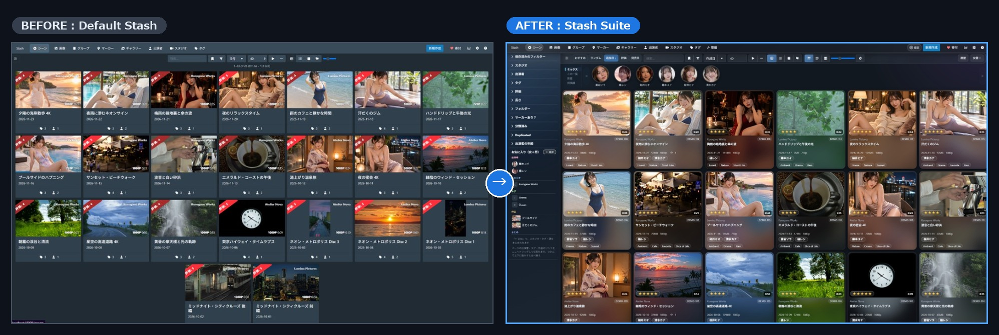
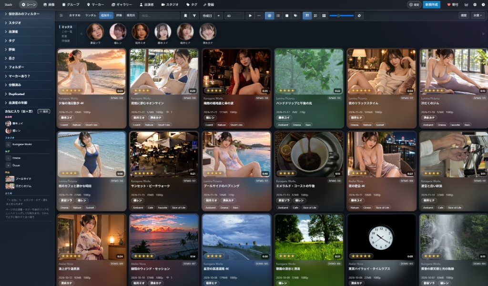
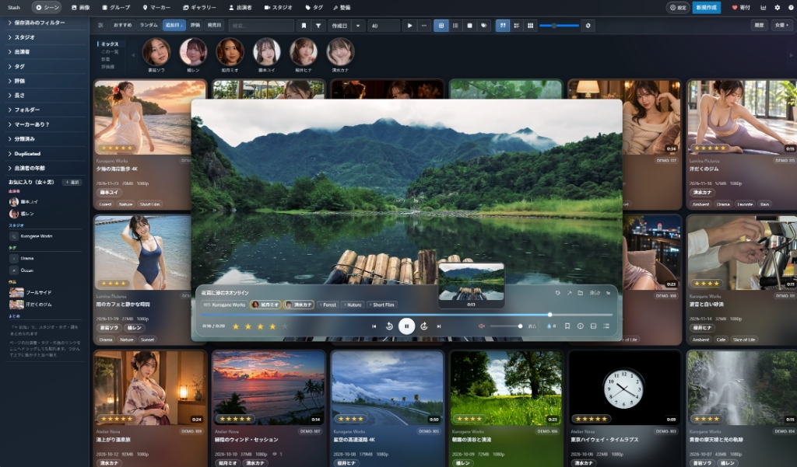
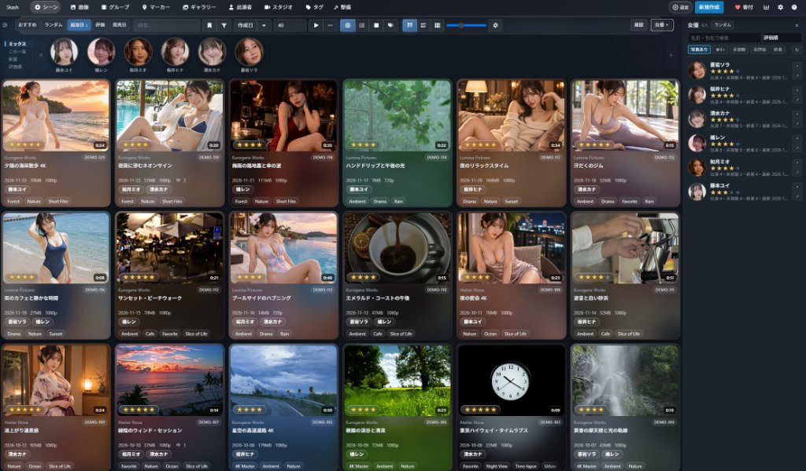
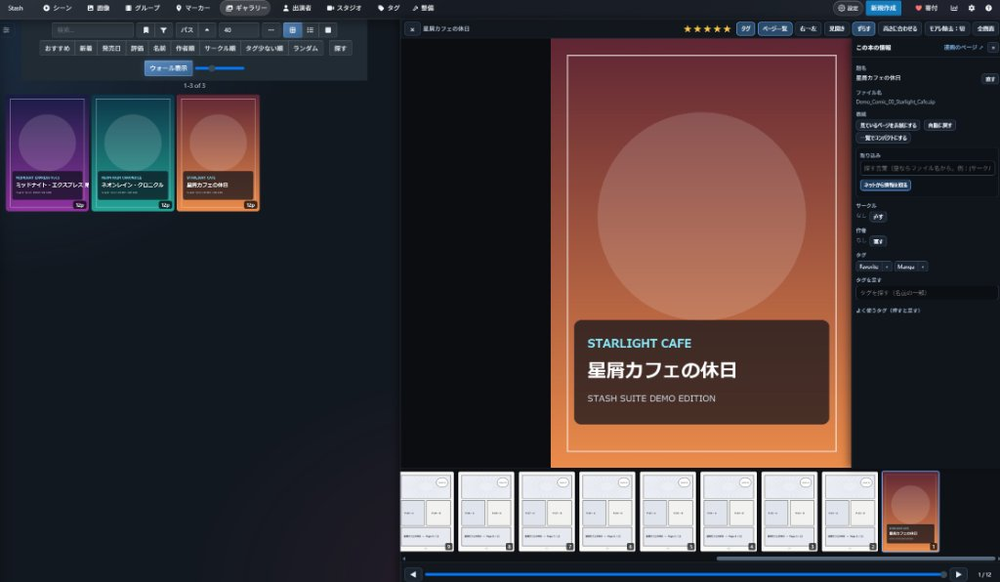
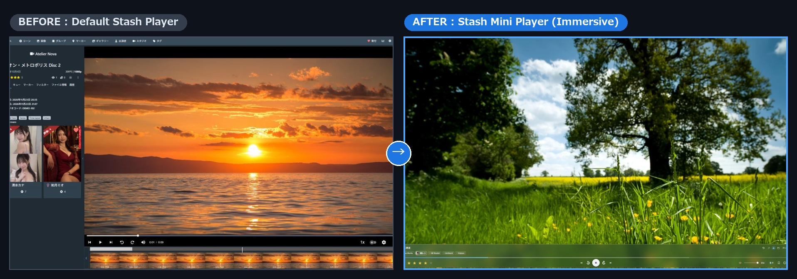

# Stash Suite (무료 버전 / Free Edition)

[English](./README.md) | [日本語](./README_JA.md) | [繁體中文](./README_ZH_TW.md) | [简体中文](./README_ZH_CN.md) | **한국어**

[StashApp](https://stashapp.cc/)의 탐색, 재생, 라이브러리 정리, 만화 열람 경험을 크게 향상시키는 통합 플러그인 모음입니다. 대용량 **JAV·로컬 영상 및 만화/동인지 컬렉션** 관리에 최적화되어 있습니다.  
별도의 Python 패키지(`pip`)나 추가 서버 없이, 폴더를 Stash의 `plugins` 디렉터리에 복사하기만 하면 바로 사용할 수 있습니다.

- **5개 언어 기본 지원**: 한국어 / 日本語 / English / 繁體中文 / 简体中文 (브라우저 언어 자동 감지 및 설정에서 언제든 변경 가능)
- **멀티 OS 지원**: Windows / macOS / Linux / Docker

---

## 스크린샷

| 메인 목록 (얼굴 스트립·즐겨찾기 보드·경량 카드) | Stash Mini Player (Premium: 즉시 재생) |
| :---: | :---: |
|  |  |

| 강화 출연자 패널 (Free) | 전용 만화 뷰어 (Premium) |
| :---: | :---: |
|  |  |

---

## 무료 버전 포함 기능 (`stashSuite` 단일 폴더 통합 · 총 11개)

- **Suite Core**: 공통 기반, 10종 다크/글래스 테마(기본: 미드나잇), 탭 방식 통합 설정 화면, 외부 플레이어 직접 실행
- **Server Store**: 모든 설정을 Stash 서버에 자동 동기화 (기기·브라우저 간 유지)
- **Quick Genres**: 원클릭 정렬 바, 시청 기록 서랍, 즐겨찾기 보드, 얼굴 스트립, 강화된 출연자 패널(사진 우선, 별명 검색, 즉시 평점, 랜덤 선택)
- **Light Scene Cards**: 초경량 씬 카드 (세로/가로/표지 전용 레이아웃, 16개 항목 커스텀, 사전 생성 불필요한 **원본 영상 직접 다이제스트 호버 미리보기** 기본 적용)
- **Scene Card Rarity**: 출연자 평점 색상 표시 및 클릭식 출연자 카드 (씬 카드 발광 연출 6종은 기본 꺼짐, 설정에서 즉시 켜기/끄기 가능)
- **Grid Player**: 카드를 `Shift + 클릭`하여 최대 9개 화면 동시 재생 (부드럽게 모드·전체 화면 지원)
- **Click Popovers**: 카드의 태그·출연자 팝업을 클릭 열기/닫기 방식으로 변경
- **Search History**: 검색창에 최근 검색 기록 표시
- **Auto Backup**: 7일마다 Stash DB 자동 안전 백업
- **Sharp Covers**: Web Worker 기반 고화질 샤프 커버 리사이징
- **View Mode**: 선택형 카테고리 모드 전환 (기본 꺼짐, 설정에서 활성화 가능)

---

## Free 무료 버전 vs. Premium 유료 버전 비교

| 기능 | Free 무료 | Premium 유료 |
| :--- | :---: | :---: |
| 10종 테마, 통합 설정 화면, 5개 언어 지원 (`Suite Core`) | ✅ | ✅ |
| 서버 자동 설정 동기화, 7일 주기 자동 DB 백업 | ✅ | ✅ |
| 초경량 씬 카드, 고화질 커버 축소, 평점 연출 | ✅ | ✅ |
| Quick Genres (얼굴 스트립, 즐겨찾기 보드, 강화 출연자 패널) | ✅ | ✅ |
| 최대 9화면 동시 재생 `Grid Player`, 검색 기록, 클릭 팝업 | ✅ | ✅ |
| **Stash Mini Player** (카드 클릭 즉시 재생, 평점·태그 편집·스크래핑·나중에 보기) | — | ✅ |
| **Split Parts** (`-A/-B`, `_1/_2` 등 분할 영상 자동 통합 및 연속 재생) | — | ✅ |
| **Library Hub** (정리율 대시보드 및 안전한 5단계 일괄 자동 정리·되돌리기) | — | ✅ |
| **Tag Weighted Recommendations** (태그 선호 가중치+출연자+미시청 보너스 추천 정렬) | — | ✅ |
| **Manga Viewer** (우철/양면 보기/관성 스크롤/월 뷰 전용 만화 뷰어) | — | ✅ |

> **Premium 유료 버전 구매**: [BOOTH 공식 샵](https://booth.pm/ja/items/9209264) *(Payhip 글로벌 스토어 오픈 예정)*  
> **최신 소식 및 업데이트**: [공식 X (@stashsuite)](https://x.com/stashsuite)  
> Free 버전에서 Premium 버전으로 업그레이드할 때는 폴더를 덮어쓰기 복사하기만 하면 되며, `Server Store`에 저장된 설정은 그대로 유지됩니다.

---

## 설치 방법 (3단계)

1. 이 저장소의 **Code → Download ZIP** (또는 Releases 최신 ZIP)을 다운로드하여 압축을 풉니다.
2. 압축을 푼 **`stashSuite` 폴더(1개 폴더)**를 Stash의 `plugins` 폴더에 복사합니다 (Premium 버전은 `stashSuite`, `libraryHub`, `splitParts` 3개 폴더).
   - **Windows 기본 경로**: `C:\Users\<사용자명>\.stash\plugins\`
   - **macOS / Linux 기본 경로**: `~/.stash/plugins/`
   - **Docker**: 컨테이너의 `/root/.stash/plugins`에 마운트된 호스트 폴더
3. Stash에서 **Settings → Plugins → Reload Plugins**를 누른 뒤 페이지를 새로고침(`F5`)합니다.

---

## 라이선스

개인 용도로만 사용할 수 있으며 재배포, 재판매, 공개 업로드는 금지됩니다. 자세한 내용은 [LICENSE.txt](./LICENSE.txt) 및 [THIRD_PARTY_NOTICES.txt](./THIRD_PARTY_NOTICES.txt)를 참고하세요.
