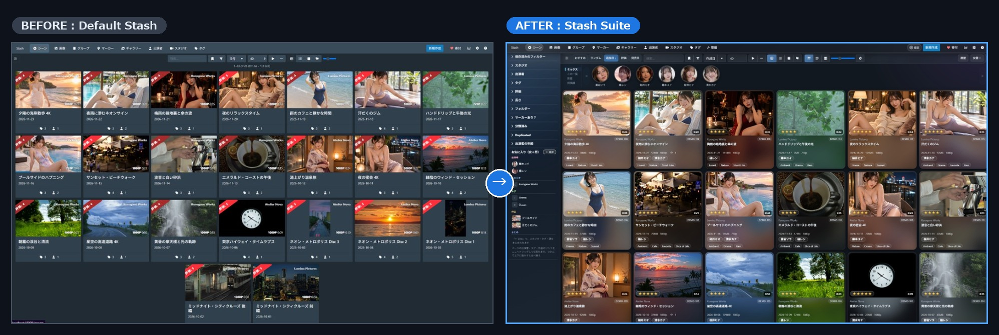
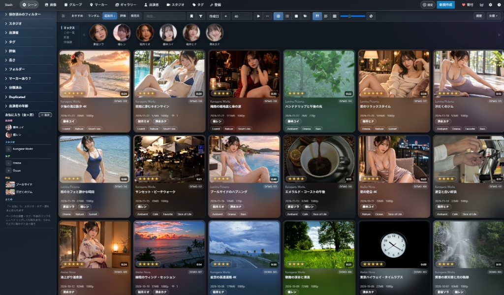
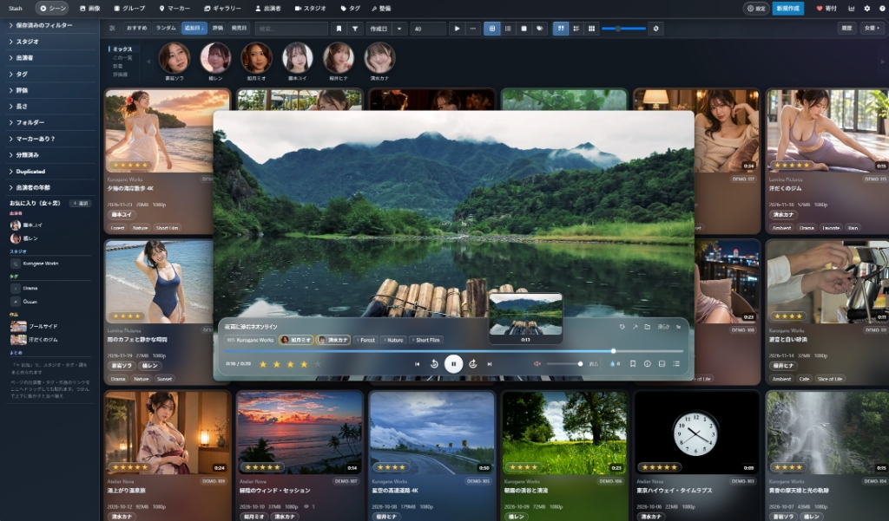
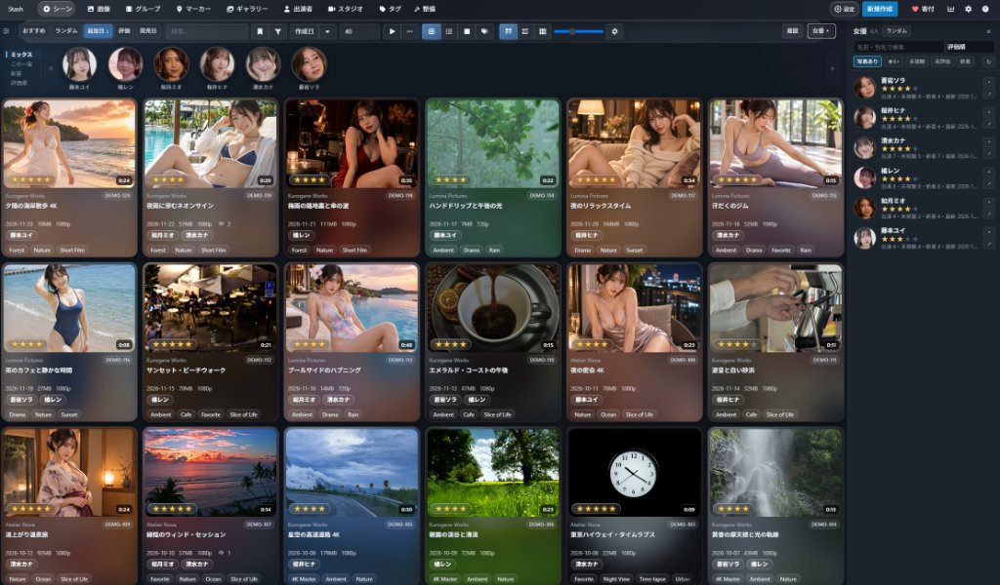
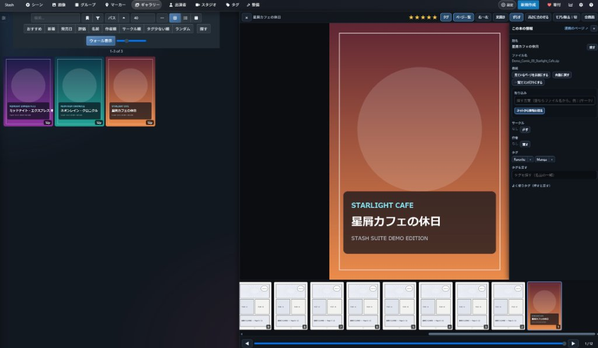
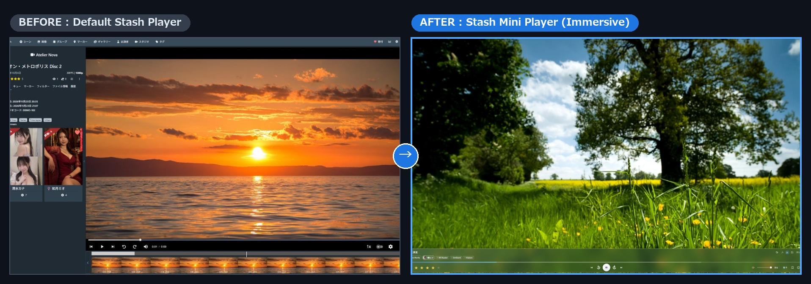

# Stash Suite (免费版 / Free Edition)

[English](./README.md) | [日本語](./README_JA.md) | [繁體中文](./README_ZH_TW.md) | **简体中文** | [한국어](./README_KO.md)

专为 [StashApp](https://stashapp.cc/) 打造的界面与媒体库增强插件套装，针对海量 **JAV、本地视频与漫画／同人志收藏** 深度优化，全面提升浏览、播放、整理与阅读体验。  
无需安装额外的 Python 依赖（`pip`）或附加服务器，只需将文件夹复制到 Stash 的 `plugins` 目录即可直接使用。

- **内置 5 种语言**：简体中文 / 繁體中文 / 日本語 / English / 한국어（自动检测并可在设置中随时切换）
- **跨平台支持**：Windows / macOS / Linux / Docker

---

## 界面截图

| 主界面总览（面部横条・收藏看板・轻量卡片） | Stash Mini Player（Premium：即刻播放） |
| :---: | :---: |
|  |  |

| 增强版演员抽屉（Free） | 专用漫画阅读器（Premium） |
| :---: | :---: |
|  |  |

---

## 免费版收录功能（整合于单个 `stashSuite` 文件夹・共 11 项）

- **Suite Core**：共用核心、10 种深色／毛玻璃主题（默认：午夜蓝）、标签式统一设置面板、直接调用外部播放器
- **Server Store**：将所有设置自动同步至 Stash 服务器，跨设备・跨浏览器无缝保留
- **Quick Genres**：一键排序栏、观看历史抽屉、收藏看板、演员面部横条、增强版演员抽屉（有图优先、别名搜索、即时评分、随机抽取）
- **Light Scene Cards**：超轻量场景卡片（竖版／横版／纯封面布局、16 项自定义显示、默认免预先生成的**原片直接精华悬停预览**）
- **Scene Card Rarity**：演员评分着色与点击式演员卡片（场景卡片发光特效默认关闭，可在设置实时开关）
- **Grid Player**：按住 `Shift + 点击` 场景卡片，最多支持 9 画面同时播放（支持流畅模式与全屏）
- **Click Popovers**：将卡片标签／演员弹窗改为点击开关
- **Search History**：搜索框显示最近搜索记录
- **Auto Backup**：每 7 天自动安全备份 Stash 数据库
- **Sharp Covers**：通过 Web Worker 实现高质量锐化封面缩放
- **View Mode**：可选分类模式切换（默认关闭，可在设置中开启）

---

## Free 免费版 vs. Premium 付费版对比

| 功能项目 | Free 免费版 | Premium 付费版 |
| :--- | :---: | :---: |
| 10 种主题、统一设置界面、5 语言支持（`Suite Core`） | ✅ | ✅ |
| 服务器自动同步设置、每 7 天自动备份数据库 | ✅ | ✅ |
| 超轻量卡片、高质量封面缩放、评分特效 | ✅ | ✅ |
| Quick Genres（面部横条、收藏看板、增强演员面板） | ✅ | ✅ |
| 9 画面同时播放 `Grid Player`、搜索记录、点击弹窗 | ✅ | ✅ |
| **Stash Mini Player**（点击卡片即刻播放、评分、编辑标签、刮削与稍后观看） | — | ✅ |
| **Split Parts**（自动合并 `-A/-B`、`_1/_2` 等分段视频并无缝连续播放） | — | ✅ |
| **Library Hub**（整理进度仪表盘、安全的 5 阶段批量自动整理与一键回滚） | — | ✅ |
| **Tag Weighted Recommendations**（基于标签权重＋演员＋未观看加成的智能推荐排序） | — | ✅ |
| **Manga Viewer**（右翻／双页跨页／惯性滚动／瀑布流墙面专用漫画阅读器） | — | ✅ |

> **购买 Premium 付费版**：[BOOTH 官方商店](https://booth.pm/ja/items/9209264) *(Payhip 全球商店即将上线)*  
> **最新更新动态**：[官方 X (@stashsuite)](https://x.com/stashsuite)  
> 从免费版升级到付费版只需直接覆盖复制文件夹，通过 `Server Store` 保存的所有设置会自动保留。

---

## 安装步骤（3 步）

1. 点击本仓库的 **Code → Download ZIP**（或从 Releases 下载最新 ZIP）并解压。
2. 将里面的 **`stashSuite` 文件夹（仅 1 个文件夹）** 复制到 Stash 的 `plugins` 目录（Premium 版为 `stashSuite`、`libraryHub`、`splitParts` 共 3 个文件夹）：
   - **Windows 默认路径**：`C:\Users\<用户名>\.stash\plugins\`
   - **macOS / Linux 默认路径**：`~/.stash/plugins/`
   - **Docker 环境**：映射到容器 `/root/.stash/plugins` 的宿主机目录
3. 打开 Stash，进入 **设置 → 插件（Plugins）→ 重新加载插件（Reload Plugins）**，然后刷新页面（`F5`）。

---

## 许可说明

仅供个人使用，禁止任何形式的再分发、转售或公开上传。详情请查阅 [LICENSE.txt](./LICENSE.txt) 与 [THIRD_PARTY_NOTICES.txt](./THIRD_PARTY_NOTICES.txt)。
