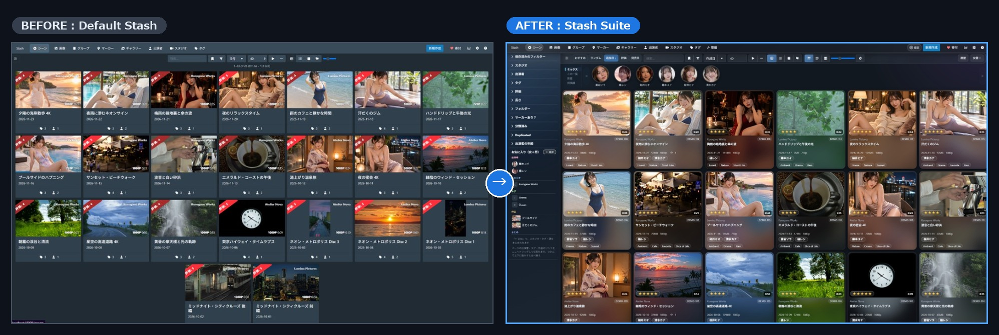
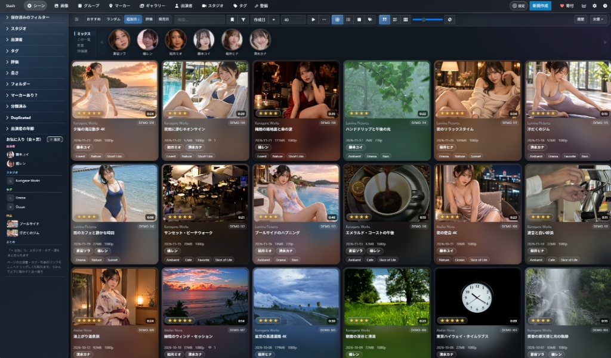
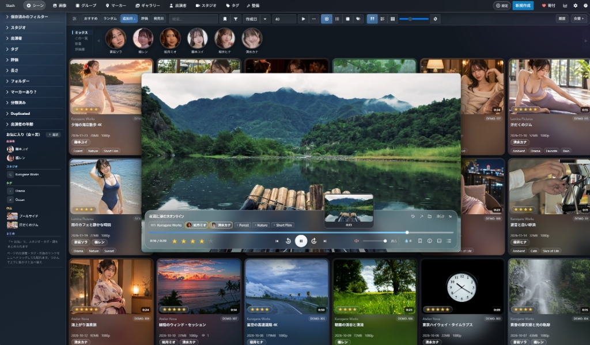
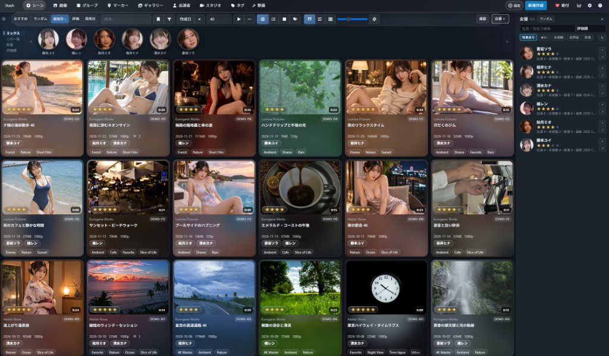
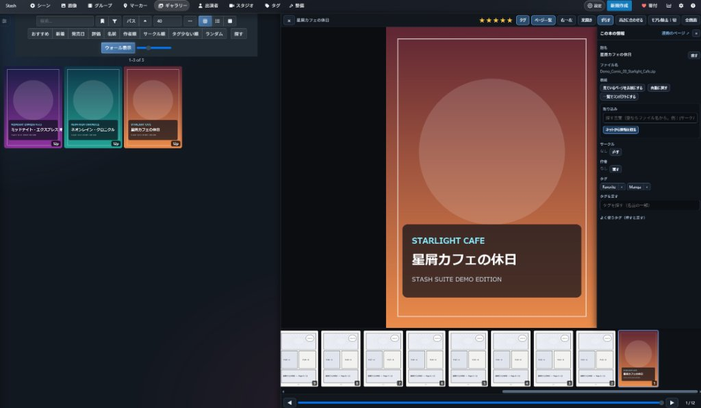
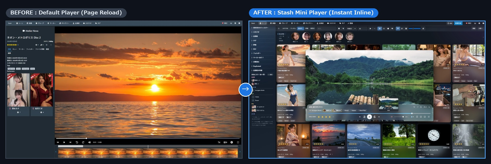

# Stash Suite (免費版 / Free Edition)

[English](./README.md) | [日本語](./README_JA.md) | **繁體中文** | [简体中文](./README_ZH_CN.md) | [한국어](./README_KO.md)

專為 [StashApp](https://stashapp.cc/) 打造的介面與媒體庫強化外掛套組，針對大量 **JAV、本地影片與漫畫／同人誌收藏** 最佳化，全面提升瀏覽、播放、整理與閱讀體驗。  
無需安裝額外的 Python 套件（`pip`）或附加伺服器，只需將資料夾複製到 Stash 的 `plugins` 目錄即可立即使用。

- **內建 5 種語言**：繁體中文 / 简体中文 / 日本語 / English / 한국어（自動偵測並可於設定中隨時切換）
- **跨平台支援**：Windows / macOS / Linux / Docker

---

## 介面截圖

| 主畫面總覽（臉部條列・最愛看板・輕量卡片） | Stash Mini Player（Premium：即時播放） |
| :---: | :---: |
|  |  |

| 強化版演員面板（Free） | 專用漫畫閱讀器（Premium） |
| :---: | :---: |
|  |  |

---

## 免費版收錄外掛（11 個）

- **Suite Core**：共用核心、10 種深色／毛玻璃主題、分頁式整合設定介面、直接呼叫外部播放器
- **Server Store**：將所有外掛設定自動同步至 Stash 伺服器，跨裝置・跨瀏覽器無縫沿用
- **Quick Genres**：一鍵排序列、未觀看 / ★4+ / 新上架開關、最愛看板、演員臉部條列、強化版演員面板（優先顯示有照片、別名搜尋、即時評分、隨機抽選）
- **Light Scene Cards**：超輕量場景卡片（直式／橫式／純封面版面、16 項自訂欄位、懸停預覽）
- **Scene Card Rarity**：依評分顯示卡片視覺特效（6 種主題）與點擊式演員卡片
- **Grid Player**：按住 `Shift + 點擊` 場景卡片，最多可同時播放 9 個畫面
- **Click Popovers**：將卡片標籤／演員浮動視窗改為點擊開關
- **Search History**：搜尋列顯示近期搜尋紀錄
- **Auto Backup**：每 7 天自動安全備份 Stash 資料庫
- **Sharp Covers**：透過 Web Worker 進行高品質銳利化封面縮圖
- **View Mode**：可選分類切換模式（預設關閉，可於設定中開啟）

---

## Free 免費版 vs. Premium 付費版比較

| 功能項目 | Free 免費版 | Premium 付費版 |
| :--- | :---: | :---: |
| 10 種主題、整合設定介面、5 語言支援（`Suite Core`） | ✅ | ✅ |
| 伺服器自動同步設定、每 7 天自動備份資料庫 | ✅ | ✅ |
| 超輕量卡片、高品質封面縮圖、評分特效 | ✅ | ✅ |
| Quick Genres（臉部條列、最愛看板、強化演員面板） | ✅ | ✅ |
| 9 畫面同時播放 `Grid Player`、搜尋紀錄、點擊浮動視窗 | ✅ | ✅ |
| **Stash Mini Player**（點擊卡片即時播放、評分、編輯標籤、刮削與稍後觀看） | — | ✅ |
| **Split Parts**（自動合併 `-A/-B`、`_1/_2` 等分段影片並無縫連續播放） | — | ✅ |
| **Library Hub**（整理完成度儀表板、安全的 5 階段批次自動整理與一鍵還原） | — | ✅ |
| **Tag Weighted Recommendations**（依標籤喜好權重＋演員＋未觀看加成智慧推薦排序） | — | ✅ |
| **Manga Viewer**（右翻／雙頁跨頁／慣性捲動／瀑布流牆面專用漫畫閱讀器） | — | ✅ |

> 從免費版升級至付費版只需直接覆蓋複製資料夾，透過 `Server Store` 儲存的設定將完整保留。

---

## 安裝步驟（3 步驟）

1. 點擊本儲存庫的 **Code → Download ZIP**（或從 Releases 下載最新 ZIP）並解壓縮。
2. 將裡面的**各外掛資料夾**（`suiteCore`、`serverStore`、`lightCards` 等）複製到 Stash 的 `plugins` 資料夾：
   - **Windows 預設路徑**：`C:\Users\<使用者名稱>\.stash\plugins\`
   - **macOS / Linux 預設路徑**：`~/.stash/plugins/`
   - **Docker 環境**：對應至容器 `/root/.stash/plugins` 的主機資料夾
3. 開啟 Stash，前往 **設定 → 外掛（Plugins）→ 重新載入外掛（Reload Plugins）**，再重新整理頁面（`F5`）。

---

## 授權說明

僅供個人使用，禁止任何形式的再散布、轉售或公開上傳。詳細條款請參閱 [LICENSE.txt](./LICENSE.txt) 與 [THIRD_PARTY_NOTICES.txt](./THIRD_PARTY_NOTICES.txt)。
